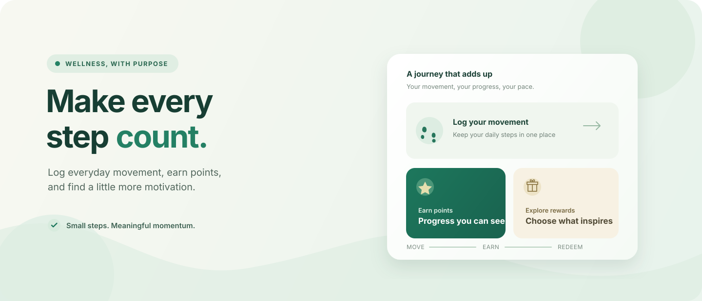

# Health Rewards

**Make every step count.** Health Rewards is a full-stack wellness app for logging daily steps, earning points, exploring rewards, and keeping track of your progress.

<p align="center">
  
</p>

> **Illustration, not a product screenshot.** The visual above summarizes the app's movement-to-rewards flow.

## What you can do

- **Track steps:** add, edit, and review step records.
- **Earn points:** points are calculated from steps using the configured steps-to-points ratio (100 steps per point by default).
- **Explore rewards:** browse the reward catalog, redeem available points, and view redemption history.
- **See your progress:** use the dashboard, activity analytics, and leaderboard.
- **Manage the app:** role-restricted admin pages support user and reward management, reports, and dashboard summaries.
- **Get wellness guidance:** the app includes insight, recommendation, and chat routes.

## Technology

| Area | Stack |
| --- | --- |
| Frontend | React 18, React Router, Axios, Chart.js |
| Backend | Node.js, Express, Mongoose |
| Data | MongoDB |
| Authentication | JSON Web Tokens and bcryptjs |

## How it fits together

```text
React app (frontend/) ── REST API ── Express app (backend/) ── MongoDB
                                      ├── Authentication and user profiles
                                      ├── Steps, points, rewards, and redemptions
                                      ├── Leaderboard and activity analytics
                                      ├── Admin operations
                                      └── Insights, recommendations, and chat
```

```text
.
├── backend/                 # API, models, business logic, and tests
├── frontend/                # React application
├── docs/                    # Setup, architecture, and development guides
│   └── assets/              # README illustration
├── k8s/                     # Kubernetes manifests
├── nginx/                   # Nginx configuration
├── docker-compose.yml       # Container orchestration
└── .github/workflows/       # CI and repository workflows
```

## Run locally

### Prerequisites

- Node.js 20 (the version used by CI) and npm
- MongoDB, local or hosted, with a database available to the backend

### 1. Configure and start the backend

```bash
cd backend
npm ci
```

Copy `backend/.env.example` to `backend/.env`, then set the required `MONGODB_URI` and a private `JWT_SECRET` of at least 32 characters. Keep `.env` local and never commit real credentials.

```bash
npm run dev
```

The backend listens on port 5000 by default.

### 2. Configure and start the frontend

In another terminal:

```bash
cd frontend
npm ci
```

Set `REACT_APP_API_BASE_URL` in the frontend's local environment to point to your backend API, then run:

```bash
npm start
```

Open the frontend at `http://localhost:3000`.

### Optional demo data

`backend/seed.js` is an opt-in development utility that **deletes and recreates** the demo users, steps, and rewards collections. Only use it with a disposable local development database, never with production or real user data. It requires `NODE_ENV=development` and `SEED_DEMO_DATA=true`; see [Environment setup](docs/ENVIRONMENT_SETUP.md) before running it. No demo passwords are published in this README.

## API overview

The API is mounted under `/api`. Main route groups:

| Route | Purpose |
| --- | --- |
| `/api/auth` | Registration, login, and authentication profile |
| `/api/user` | User profile and password management |
| `/api/steps` | Step entry and history |
| `/api/rewards` | Reward catalog, redemption, and redemption history |
| `/api/leaderboard` | Rankings and user rank |
| `/api/analytics` | Activity analytics |
| `/api/admin` | Admin dashboard, users, rewards, and reports |
| `/api/ai` | Insights, recommendations, and chat |

See the [setup guide](docs/SETUP_GUIDE.md) for additional API and configuration details.

## Tests and CI

Run the project checks from their respective directories:

```bash
# Backend tests
cd backend
npm test

# Frontend tests
cd frontend
npm test -- --watchAll=false

# Frontend production build
npm run build
```

The GitHub Actions workflow runs backend and frontend tests and builds the frontend; pull requests to `main` also run dependency review. There is no separate frontend lint script configured.

## Deployment assets

The repository includes Docker Compose, Nginx configuration, and Kubernetes manifests. These are deployment assets, not a guarantee of a configured hosted deployment: review their settings, provide the required environment configuration and MongoDB service, and verify them in your own environment before use.

## Contributing

1. Create a focused branch and make your change.
2. Run the relevant backend tests, frontend tests, and build.
3. Open a pull request with a concise description and verification notes.

For code conventions and workflows, see the [development guide](docs/DEVELOPMENT_GUIDE.md). For system structure, see [architecture](docs/ARCHITECTURE.md).

## Possible next steps

Ideas for future work—not features currently promised here—include wearable integrations, notifications, and additional analytics.
